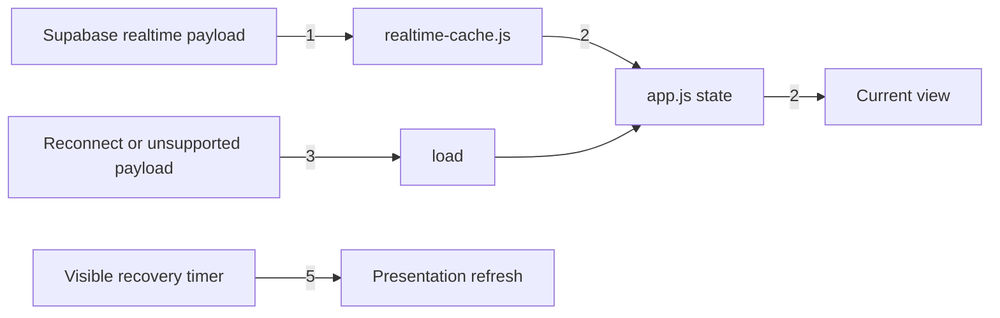
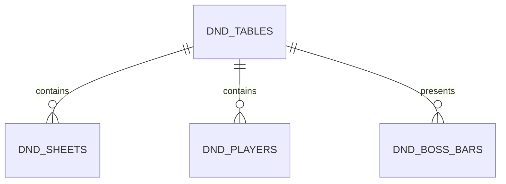

# Realtime performance

**Approved**: 2026-10-27 - user: "sim"

## Problem

Any subscribed database change currently reloads the complete client model: sixteen broad queries and two follow-up queries. Separately, the visible page polls presentation, history, and boss data every five seconds and every render fetches boss data again. A player pays for unrelated database reads and sees needless redraw work; a larger table makes the cost grow with all accessible rows rather than with the changed record.

After this ships, an ordinary realtime update refreshes only its local collection, boss bars are fetched once per selected table and subsequently updated by realtime, and the recovery poll is limited to the current presentation state. The application still converges with Supabase after reconnecting.

## Shape

The change reuses the existing `state`, Supabase realtime channel, and `createLatestRequestGate`; it does not add a client storage layer. The event-to-state rules live in a small pure module reachable from Node tests, while `app.js` owns the network request and DOM update.

1. Supabase realtime payload -> `dist/realtime-cache.js` (new) - upserts or removes the payload row in the matching in-memory collection.
2. `dist/app.js` (exists) - applies the event to `state`, preserves an edited sheet, and renders only after a relevant change.
3. `dist/app.js` (exists) -> Supabase - reloads the full model only after a reconnect or when an unsupported payload requires recovery.
4. `dist/app.js` (exists) -> current table - fetches boss bars once after selection; realtime events refresh them thereafter.
5. timer -> `dist/app.js` (exists) - polls presentation state only while the document is visible, at a longer recovery interval.

**Changes underneath**

| Front | What changes |
| --- | --- |
| domain | a realtime event updates one local collection instead of always triggering a complete reload |
| stored data | nothing to migrate |
| readers | current dashboard, editor, progression, and boss HUD read the same `state` shape |

New: nothing - read only. One-way constraints: none.

## Surface

None - nothing consumed outside the browser client.

## Landing

None - this introduces no persisted schema, public contract, dependency, or irreversible cache format.

## Criteria

### S1: Relevant realtime updates (P1)

**Acceptance Criteria**

1. WHEN a supported realtime INSERT or UPDATE payload arrives THEN the client SHALL replace or append exactly the row with that payload id in its matching in-memory collection.
2. WHEN a supported realtime DELETE payload arrives THEN the client SHALL remove exactly the row with that payload old id from its matching in-memory collection.
3. WHILE the open sheet has unsaved edits, WHEN its matching realtime payload arrives THEN the client SHALL retain the local edited sheet rather than overwrite it.
4. IF a realtime payload cannot be safely applied THEN the client SHALL schedule the existing full reload recovery path.

### S2: Background work (P1)

**Acceptance Criteria**

5. WHEN the selected table changes THEN the client SHALL fetch boss bars once for that table before rendering their controls.
6. WHILE the selected table has already fetched boss bars, WHEN the page renders THEN the client SHALL not issue another boss-bar request solely because of that render.
7. WHILE the document is visible, WHEN the recovery timer runs THEN the client SHALL refresh the current presentation state only, at an interval no shorter than 30 seconds.

### S3: Local storage decision (P1)

**Acceptance Criteria**

8. The client SHALL not persist tables, sheets, players, notes, media metadata, or authentication-derived data in `localStorage`.
9. WHEN the browser closes or a user signs out THEN the in-memory realtime model SHALL remain the only client-side copy introduced by this feature.

## Out of scope

| Excluded | Why |
| --- | --- |
| `localStorage` cache | It can expose mesa and private-sheet data to another user of the same browser, becomes stale against realtime, and needs a versioned invalidation/privacy design not justified by the measured bottleneck. |
| Cache headers and asset hashing | Independent delivery/cache policy work. |
| Database schema or RLS changes | The issue is client refresh amplification, not a demonstrated query-plan deficiency. |

## Assumptions

| Assumption | Chosen default | Rationale | Confirmed? |
| --- | --- | --- |
| Safe cached data | in-memory state only | preserves existing privacy and sign-out semantics | n |
| Recovery interval | 30 seconds | realtime remains primary; timer is only a fallback | n |

**Open questions:** none - the user delegated implementation priority; the assumptions above are reversible and do not alter product data.

## Differences from the source

None - no binding visual source applies.

## Sources

- user request on 2026-10-27 - binding - implement the most important performance improvements and assess `localStorage`.
