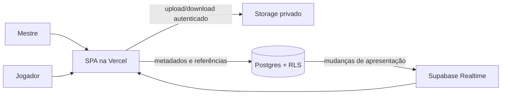
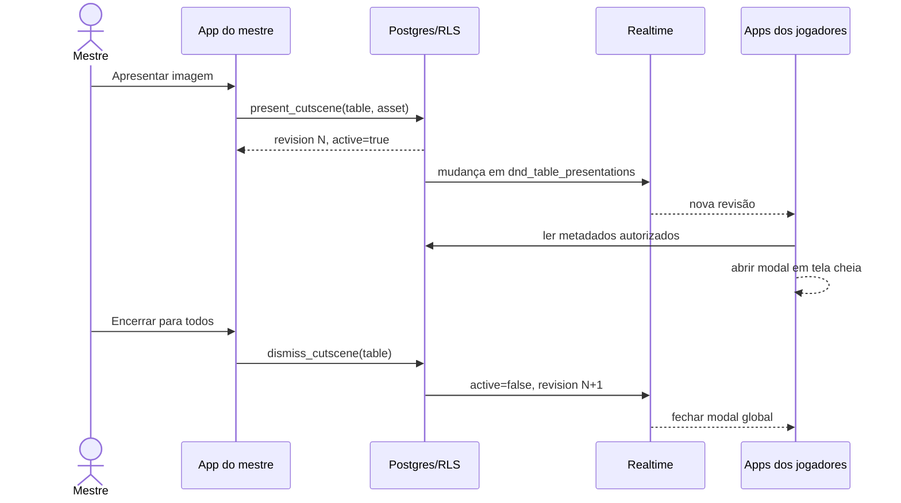

# ADR — Retratos, mapa da mesa e cutscenes

- **Status:** Proposto
- **Data:** 2026-10-11
- **Projeto:** Grimório — Fichas de D&D

## Contexto

O Grimório é uma SPA estática em JavaScript publicada na Vercel. Autenticação,
dados, autorização e sincronização em tempo real usam Supabase. A aplicação já
possui os conceitos de mesa, mestre, jogador e ficha, com acesso protegido por
RLS. A interface usa apenas a chave publicável e não possui backend próprio.

Três recursos visuais foram solicitados:

1. o jogador atribui um retrato à própria ficha;
2. o mestre publica e substitui o mapa consultado pelos jogadores da mesa;
3. o mestre apresenta uma imagem como cutscene simultaneamente aos jogadores
   que estiverem online.

Os três recursos compartilham armazenamento e autorização, mas possuem
semânticas diferentes: retrato e mapa são conteúdo persistente; cutscene é uma
apresentação temporária e sincronizada.

## Requisitos confirmados

- Jogadores podem definir a imagem de personagem das fichas que controlam.
- O mestre pode definir ou substituir o mapa atual da mesa.
- Jogadores com acesso ativo à mesa podem consultar o mapa atual.
- O mestre pode exibir uma cutscene para todos os jogadores online na mesa.
- Arquivos e metadados devem respeitar o isolamento entre mesas.
- A solução deve se integrar à stack atual sem introduzir um backend separado.

## Hipóteses adotadas

- A escala permanece em dezenas de mesas e centenas de usuários, com poucos
  uploads simultâneos por mesa.
- Até 50 participantes simultâneos por mesa é uma margem confortável para o
  desenho inicial.
- Uma atualização visual deve aparecer normalmente em até 2 segundos para
  usuários já conectados.
- Uma indisponibilidade temporária do Realtime não pode impedir a consulta do
  último mapa ou retrato salvo.
- Imagens de personagens podem ser dados pessoais ou material privado da mesa;
  por isso, nenhum bucket será público.
- Não há requisito regulatório específico além de controle de acesso, exclusão
  e minimização de dados.
- O mestre também pode alterar ou remover o retrato de qualquer ficha da mesa.
- Cada jogador pode dispensar a cutscene apenas na própria tela; somente o
  mestre encerra a apresentação para toda a mesa.
- Quem reconectar enquanto uma cutscene estiver ativa deve visualizá-la.

## Decisão

### 1. Arquitetura geral

Continuaremos com a arquitetura atual:

- **Vercel / SPA:** seleção, pré-visualização, compressão opcional, upload,
  consulta e exibição das imagens;
- **Supabase Storage:** conteúdo binário em buckets privados;
- **Postgres:** metadados, referências ativas, versão da apresentação e
  auditoria mínima;
- **RLS:** autorização tanto das linhas de negócio quanto dos objetos;
- **Supabase Realtime:** atualização do mapa e abertura/encerramento de
  cutscenes.

Não serão usados microsserviços, filas, CDN externa ou Edge Functions no
primeiro lançamento. O upload direto do navegador é suficiente para o volume
previsto, desde que limitado por bucket e protegido por RLS.



### 2. Buckets privados

Serão criados dois buckets, separados porque seus limites e permissões de
escrita são diferentes:

| Bucket | Conteúdo | Escrita | Leitura | Limite inicial |
|---|---|---|---|---:|
| `dnd-portraits` | retratos de ficha | mestre ou jogador responsável | quem já pode ler a ficha | 5 MB |
| `dnd-table-scenes` | mapas e cutscenes | somente mestre | membros ativos da mesa | 15 MB |

Tipos aceitos inicialmente: `image/jpeg`, `image/png` e `image/webp`. SVG será
recusado por permitir conteúdo ativo e referências externas; GIF ficará fora do
MVP para evitar animações pesadas e comportamento inconsistente.

Os caminhos serão opacos e previsíveis apenas em estrutura:

```text
dnd-portraits/{table_id}/{sheet_id}/{asset_id}.{ext}
dnd-table-scenes/{table_id}/{asset_id}.{ext}
```

Os buckets serão privados. A interface obterá URL assinada de curta duração
(sugestão: 15 minutos) quando precisar renderizar uma imagem. A URL assinada
nunca será persistida; o banco guarda somente bucket e caminho.

### 3. Modelo de dados

Será usada uma entidade comum de ativos e duas projeções do estado atual. Isso
evita misturar o ciclo de vida dos arquivos com o JSON da ficha e evita criar
conflitos artificiais com o controle de versão de `dnd_sheets`.

#### `dnd_media_assets`

| Campo | Tipo | Regra |
|---|---|---|
| `id` | `uuid` | chave primária |
| `table_id` | `uuid` | FK para `dnd_tables`, obrigatória |
| `sheet_id` | `uuid null` | obrigatória apenas para `portrait` |
| `kind` | enum | `portrait`, `map`, `cutscene` |
| `bucket_id` | `text` | coerente com `kind` |
| `object_path` | `text` | único; nunca é URL assinada |
| `mime_type` | `text` | lista permitida |
| `byte_size` | `bigint` | positivo e dentro do limite do tipo |
| `width` / `height` | `integer` | dimensões após leitura no navegador |
| `created_by` | `uuid` | `auth.users.id` do autor |
| `created_at` | `timestamptz` | auditoria |
| `deleted_at` | `timestamptz null` | exclusão lógica durante limpeza |

Restrições verificam a combinação entre `kind`, bucket, presença de `sheet_id`
e limites de tamanho. Metadados enviados pelo cliente ajudam a operar a
aplicação, mas não substituem o limite e a lista MIME configurados no bucket.

#### `dnd_sheet_portraits`

| Campo | Tipo | Regra |
|---|---|---|
| `sheet_id` | `uuid` | PK/FK para `dnd_sheets` |
| `asset_id` | `uuid` | FK para ativo `portrait` da mesma ficha |
| `revision` | `bigint` | incrementada em cada substituição |
| `updated_by` | `uuid` | auditoria |
| `updated_at` | `timestamptz` | auditoria |

#### `dnd_table_presentations`

| Campo | Tipo | Regra |
|---|---|---|
| `table_id` | `uuid` | PK/FK para `dnd_tables` |
| `map_asset_id` | `uuid null` | mapa atual |
| `map_revision` | `bigint` | incrementada em cada troca/remoção |
| `cutscene_asset_id` | `uuid null` | cutscene ativa |
| `cutscene_active` | `boolean` | estado autoritativo |
| `cutscene_revision` | `bigint` | sempre incrementada ao apresentar/encerrar |
| `cutscene_started_at` | `timestamptz null` | ordenação e diagnóstico |
| `updated_by` | `uuid` | mestre que realizou a ação |
| `updated_at` | `timestamptz` | auditoria |

Uma trigger cria `dnd_table_presentations` junto com a mesa. Outra trigger (ou
funções RPC) impede referências cruzadas entre mesas, fichas, tipos de ativo e
buckets. A integridade entre essas entidades não deve depender da interface.

### 4. Contratos

As escritas que trocam uma referência ativa usarão funções Postgres chamadas
via RPC. Isso concentra autorização, validação e concorrência sem exigir uma
Edge Function.

#### `set_sheet_portrait`

Entrada:

```json
{
  "p_sheet_id": "uuid",
  "p_asset_id": "uuid",
  "p_expected_revision": 3
}
```

Autoriza mestre da mesa ou jogador ativo responsável pela ficha. Valida que o
ativo é um retrato da mesma ficha/mesa. Retorna a nova projeção. Revisão
divergente retorna conflito, evitando que duas abas se sobrescrevam em silêncio.

#### `set_table_map`

Entrada:

```json
{
  "p_table_id": "uuid",
  "p_asset_id": "uuid ou null",
  "p_expected_revision": 5
}
```

Somente o mestre pode executar. `null` remove o mapa. Valida que o ativo é um
mapa da mesma mesa e incrementa `map_revision`.

#### `present_cutscene`

Entrada:

```json
{
  "p_table_id": "uuid",
  "p_asset_id": "uuid"
}
```

Somente o mestre pode executar. Define a cutscene ativa, atualiza o horário e
sempre incrementa `cutscene_revision`, inclusive ao reapresentar a mesma imagem.

#### `dismiss_cutscene`

Entrada:

```json
{
  "p_table_id": "uuid"
}
```

Somente o mestre pode executar. Marca a apresentação como inativa, remove a
referência ativa e incrementa a revisão. O fechamento feito por um jogador é
somente estado local da interface e não chama essa operação.

Erros de domínio terão códigos estáveis para a interface traduzir:
`not_authorized`, `asset_not_found`, `asset_scope_mismatch`,
`invalid_media_type` e `revision_conflict`.

### 5. Fluxos

#### Upload e associação

1. A interface valida tipo, tamanho e dimensões antes do envio.
2. Gera `asset_id` e caminho único; nunca usa `upsert`.
3. Envia o objeto ao bucket privado.
4. Insere `dnd_media_assets` com os metadados.
5. Chama a RPC que troca a referência ativa.
6. Em falha após o upload, tenta remover o objeto e registra o erro para nova
   tentativa; uma limpeza periódica poderá remover órfãos antigos.

Storage e Postgres não compartilham a mesma transação. O caminho único e a
limpeza de órfãos tornam a falha recuperável sem sobrescrever conteúdo válido.

#### Consulta do mapa

1. Ao abrir a mesa, o cliente lê `dnd_table_presentations`.
2. Se houver `map_asset_id`, lê os metadados autorizados e solicita URL assinada.
3. A imagem aparece em uma área dedicada, com zoom, pan e opção de tela cheia.
4. Mudanças recebidas via Realtime atualizam a referência e invalidam a URL
   anterior no estado local.

O MVP entrega uma imagem consultável. Tokens, grade, neblina de guerra e
anotações compartilhadas são outro domínio e não fazem parte desta decisão.

#### Cutscene



O estado persistido é a fonte de verdade; o evento Realtime apenas reduz a
latência. Ao conectar ou reconectar, o cliente relê a linha e abre a cutscene se
ela ainda estiver ativa. Isso evita perder a apresentação durante uma oscilação
de rede.

### 6. Autorização

#### Linhas de negócio

- `dnd_media_assets SELECT`: mestre da mesa ou jogador ativo da mesa; para
  retrato, a visibilidade acompanha a visibilidade da ficha.
- `dnd_media_assets INSERT`: mestre para qualquer tipo; jogador responsável
  apenas para `portrait` da própria ficha.
- `dnd_media_assets UPDATE/DELETE`: não serão concedidos diretamente ao
  cliente no MVP; troca e remoção passam pelas funções autorizadas.
- `dnd_sheet_portraits SELECT`: mesmos usuários que podem ler a ficha.
- `dnd_table_presentations SELECT`: mestre e jogadores ativos da mesa.
- Atualizações das duas projeções não serão concedidas diretamente; somente as
  RPCs específicas poderão alterá-las.

As funções privilegiadas, se necessárias, ficarão em schema não exposto, terão
`search_path` fixo, validarão `auth.uid()` internamente e terão `EXECUTE`
revogado de `PUBLIC`, com concessão explícita a `authenticated`.

#### Objetos do Storage

Políticas em `storage.objects` repetirão o escopo relevante usando os segmentos
do caminho. Conhecer um UUID ou caminho não concede acesso. Leitura e escrita
exigem vínculo ativo com a mesa/ficha.

O modelo atual identifica jogadores por e-mail. Para estas features ele pode ser
reutilizado por compatibilidade, mas a evolução recomendada é preencher
`dnd_players.user_id` após o primeiro login e usar `auth.uid()` nas políticas.
Isso reduz dependência de comparação de e-mail e simplifica Storage e Realtime.

### 7. Realtime

`dnd_table_presentations` será adicionada à publicação usada pela aplicação. O
cliente continuará tratando a releitura autorizada do banco como fonte da
verdade.

Para o MVP, Postgres Changes é preferível a Broadcast porque:

- o estado precisa sobreviver a reconexões;
- o volume é baixo;
- a aplicação já utiliza esse mecanismo;
- evita manter dois caminhos de autorização e entrega.

Se no futuro houver ponteiros, animações ou dezenas de eventos por segundo,
esses sinais efêmeros deverão migrar para canais Broadcast privados. Mesmo
nessa evolução, o mapa e a cutscene ativa continuam persistidos.

### 8. Ciclo de vida e limpeza

- Substituir uma referência não apaga imediatamente o ativo anterior.
- Ativos sem referência ficam elegíveis para exclusão após 24 horas, permitindo
  recuperação de falhas e evitando corrida com clientes que ainda renderizam a
  URL anterior.
- Uma rotina operacional pode listar metadados órfãos e remover primeiro o
  objeto pela API de Storage e depois a linha de metadados.
- Nunca se deve apagar diretamente linhas de `storage.objects`, pois isso não
  remove necessariamente o objeto físico.
- Exclusão de mesa/ficha deve disparar uma rotina de limpeza dos respectivos
  objetos. Até essa rotina existir, a exclusão de registros deve ser bloqueada
  ou os objetos devem ser registrados para limpeza posterior.

### 9. Experiência de uso e falhas

- Mostrar prévia e progresso do upload.
- Desabilitar a confirmação até o upload terminar.
- Manter a imagem anterior se upload, metadado ou RPC falhar.
- Exibir placeholder quando não houver retrato ou mapa.
- Usar `object-fit: cover` no retrato e `contain` no mapa/cutscene.
- Não fechar a cutscene global quando um jogador usar Escape; essa ação apenas
  dispensa o modal localmente para a revisão atual.
- Uma nova `cutscene_revision` volta a abrir a apresentação mesmo que o jogador
  tenha dispensado a anterior.
- Pré-carregar a cutscene no app do mestre antes de chamar `present_cutscene`,
  reduzindo a chance de apresentar uma imagem inválida.

## Alternativas consideradas

### Salvar base64 no JSON da ficha

Rejeitada: aumenta linhas, tráfego do Realtime, conflitos de edição e custo do
banco, além de não oferecer ciclo de vida apropriado para arquivos.

### Bucket público

Rejeitada: qualquer pessoa com a URL poderia consultar imagens privadas da mesa,
mesmo após perder acesso.

### Guardar URL assinada no banco

Rejeitada: URLs expiram e sua persistência cria referências quebradas e risco de
compartilhamento fora do período pretendido.

### Cutscene apenas por Broadcast

Rejeitada no MVP: participantes que conectam alguns segundos depois ou passam
por reconexão podem perder o evento. Estado persistido com Realtime é mais
simples e confiável neste volume.

### Edge Function para todo upload

Adiada: adiciona custo operacional e um salto de rede sem necessidade no volume
atual. Deve ser reavaliada se forem exigidos antivírus, transformação confiável,
remoção de metadados, thumbnails no servidor ou moderação automática.

## Operação e observabilidade

Métricas mínimas:

- uploads iniciados, concluídos e falhos por tipo;
- bytes armazenados por mesa e por tipo;
- falhas ao gerar URL assinada;
- conflitos de revisão;
- tempo entre `cutscene_started_at` e recebimento no cliente;
- quantidade e idade de ativos órfãos.

Logs de erro devem conter `table_id`, `sheet_id`, `asset_id`, operação e código
de falha, mas nunca URL assinada, token de acesso ou conteúdo da imagem.

Alertas iniciais: taxa de falha de upload acima de 5% em 15 minutos e ativos
órfãos com mais de 48 horas.

## Plano de entrega

### Recorte recomendado para implementação com 28% de tokens restantes

É viável implementar um MVP funcional das três funcionalidades nesta rodada,
desde que o escopo permaneça restrito ao definido neste ADR:

- retrato da ficha com upload, troca, remoção e autorização;
- mapa como imagem consultável, com zoom e tela cheia;
- cutscene sincronizada, com apresentação e encerramento pelo mestre;
- Storage privado, RLS e testes essenciais de permissão.

A ordem recomendada é:

1. criar banco, buckets e políticas de acesso;
2. implementar retratos;
3. implementar mapa;
4. implementar cutscenes;
5. executar verificações locais e, quando houver acesso, validar com duas contas
   reais no Supabase.

Caso o limite disponível se torne insuficiente, retrato e mapa devem ser
concluídos primeiro, deixando cutscenes como o último incremento isolado. As
mudanças de banco devem ser estruturadas para que essa interrupção não deixe as
funcionalidades anteriores incompletas.

Ficam explicitamente fora desta rodada:

- grade, tokens, marcadores e neblina de guerra no mapa;
- edição ou transformação de imagens;
- galeria sofisticada e organização de cutscenes;
- animações e formatos adicionais como GIF;
- limpeza automática avançada de arquivos órfãos;
- thumbnails ou processamento de imagens no servidor;
- métricas e painéis operacionais além dos registros essenciais.

O principal risco da rodada não é a quantidade de código, mas a validação das
políticas do Supabase com identidades distintas e a aplicação da migração no
ambiente remoto. A implementação local não deve ser considerada pronta para
produção até que os testes de mestre, jogador responsável, outro jogador e
usuário externo sejam executados contra o ambiente integrado.

### Fase 1 — fundação

- vincular jogadores autenticados a `user_id` quando possível;
- criar buckets privados e seus limites;
- criar tabelas, restrições, RPCs e RLS;
- adicionar `dnd_table_presentations` à publicação Realtime;
- criar testes SQL de mestre, jogador responsável, outro jogador e intruso.

### Fase 2 — retratos

- componente de seleção, preview, upload, troca e remoção;
- exibição na lista de fichas e no editor;
- concorrência por `revision` e tratamento de órfãos.

### Fase 3 — mapa

- gerenciamento pelo mestre;
- visualização com zoom, pan e tela cheia;
- atualização automática para membros conectados.

### Fase 4 — cutscenes

- seleção/reuso de imagem pelo mestre;
- apresentação em tela cheia e encerramento global;
- dispensa local pelo jogador;
- teste com duas contas e reconexão durante apresentação.

### Fase 5 — operação

- limpeza agendada de órfãos;
- painel ou consulta de consumo por mesa;
- reavaliação de limites com dados reais.

## Critérios de aceite arquiteturais

- Um usuário de outra mesa não consegue listar, baixar ou referenciar o ativo.
- Um jogador não consegue alterar mapa ou iniciar/encerrar cutscene, mesmo
  chamando a API diretamente.
- Um jogador só consegue alterar retrato de ficha sob sua responsabilidade.
- Falha após upload não substitui a imagem anterior.
- Trocas concorrentes retornam conflito em vez de sobrescrever silenciosamente.
- O mapa permanece disponível se Realtime estiver temporariamente indisponível.
- Uma cutscene ativa aparece após reconexão; uma encerrada não reaparece.
- Remover acesso à mesa também remove o acesso aos objetos privados.
- Nenhuma chave secreta ou `service_role` é entregue ao navegador.

## Riscos

| Risco | Local no design | Severidade | Mitigação |
|---|---|---:|---|
| Vazamento entre mesas | RLS de dados/Storage | Alta | buckets privados, políticas por vínculo e testes negativos |
| Arquivos órfãos | fronteira Storage/Postgres | Média | caminho único, compensação e limpeza após 24 h |
| Abuso de armazenamento | upload direto | Média | MIME/tamanho por bucket, cotas futuras e métricas |
| Imagem maliciosa | upload/renderização | Alta | recusar SVG, limitar MIME/tamanho e renderizar como imagem |
| Cutscene perdida | conexão Realtime | Média | estado persistido e releitura na reconexão |
| Cutscene reaparecer indevidamente | estado local/revisão | Média | `active` + revisão monotônica |
| Políticas complexas por e-mail | identidade atual | Média | migrar associação para `dnd_players.user_id` |
| Exclusão incompleta | ciclo de vida | Média | apagar via API de Storage e auditar órfãos |

## Perguntas abertas antes da implementação

1. O mapa será apenas uma imagem com zoom/pan ou já precisa de grade, marcadores,
   tokens e neblina de guerra? Esta decisão assume apenas imagem.
2. Jogadores podem ver os retratos de todas as fichas não secretas da mesa ou
   somente o próprio? A política final deve acompanhar a regra de leitura das
   fichas.
3. Cutscenes anteriores precisam formar uma galeria reutilizável pelo mestre?
   O modelo suporta reuso, mas o MVP pode expor apenas upload e apresentação.
4. Os limites iniciais de 5 MB e 15 MB atendem às imagens reais do grupo?
5. Ao remover uma ficha ou mesa, a exclusão dos arquivos deve ser imediata ou
   deve existir uma janela de recuperação?

## Decisões-chave

- Binários em Storage privado; metadados e referências no Postgres.
- Estado visual fora do JSON da ficha para não criar conflitos de edição.
- Dois buckets por diferenças de permissão e tamanho.
- RPCs transacionais para troca de referências e controle de revisão.
- Postgres Changes no MVP; Broadcast reservado para interações efêmeras futuras.
- Cutscene persistida enquanto ativa para suportar reconexões.
- URLs assinadas curtas e nunca armazenadas.

